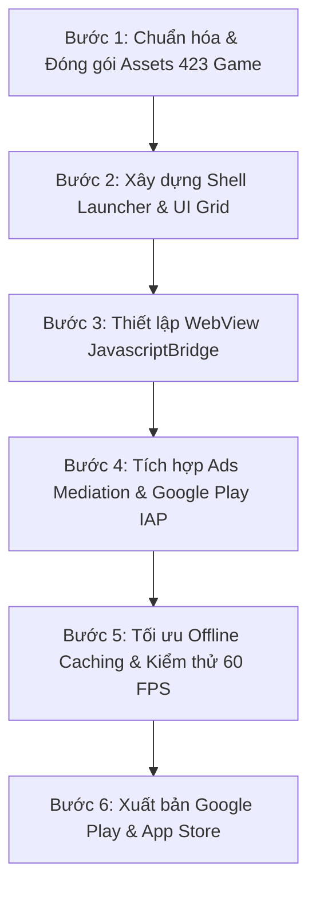

# BÁO CÁO 07: KẾ HOẠCH TÁI DỰNG ỨNG DỤNG & KIẾN TRÚC SẢN PHẨM TƯƠNG ĐƯƠNG
**Dự án:** Offline Games: No WiFi Games (`com.media720.games2020`)  
**Mục tiêu:** Trả lời chi tiết Yêu cầu 11 trong `readme.txt`.

---

## 1. Đánh Giá Khả Thi Tái Dựng (Rebuild Feasibility)

- **Mức độ khả thi:** **98% - 100%** (Rất dễ triển khai và chi phí cực thấp).
- **Lý do:**
  1. Toàn bộ 423 mini-game cốt lõi đã được trích xuất nguyên vẹn trong `GAME HTML/` cùng toàn bộ logic JavaScript, Canvas, WebAssembly, Sprites và Audio.
  2. Lớp vỏ ứng dụng (Native Shell) thực chất chỉ là một **WebView Container** kết hợp với RecyclerView/Grid hiển thị danh sách game, hệ thống Mediation Ads (AdMob/MAX) và In-App Billing đơn giản.
  3. Không phụ thuộc vào hệ thống Multiplayer thời gian thực phức tạp hay Server Game Logic nặng nề.

---

## 2. So Sánh 2 Phương Án Công Nghệ Tái Dựng Tốt Nhất

### Phương Án A: Flutter Multi-Platform (Khuyến Nghị Hàng Đầu)
- **Ưu điểm:** 
  - Viết 1 lần xuất bản đồng thời cả **Android** và **iOS** (Mở rộng thị trường sang App Store).
  - Tích hợp `webview_flutter` hoặc `flutter_inappwebview` với hiệu năng cực cao.
  - Sử dụng `google_mobile_ads`, `applovin_max` và `in_app_purchase` package chính chủ.
  - Quản lý database local bằng `drift` (SQLite ORM) hoặc `hive/isar`.
- **Thời gian ước tính:** 3 - 5 ngày để hoàn thiện bản Beta với đầy đủ 423 game.

### Phương Án B: Android Native (Kotlin + Jetpack Compose)
- **Ưu điểm:** 
  - Sao chép 1:1 kiến trúc nguyên bản của đối thủ (`com.media720.games2020`).
  - Tối ưu hóa bộ nhớ RAM và thời gian khởi động WebView nhanh nhất.
  - Sử dụng Dagger Hilt, Room Database, Media3 ExoPlayer.
- **Thời gian ước tính:** 4 - 6 ngày hoàn thiện.

---

## 3. Lộ Trình Triển Khai Chi Tiết Từng Bước (Roadmap)



### Bước 1: Chuẩn hóa Kho Mini-Game (`GAME HTML/`)
- Đưa 423 thư mục mini-game vào thư mục `assets/games/` của dự án mới.
- Kiểm tra các liên kết file tương đối (`./index.html`, `./c3runtime.js`, `./images/`).

### Bước 2: Xây dựng Launcher UI (Redesign)
- Tạo màn hình danh sách game dạng Grid 2 cột theo token thiết kế trong `Redesign/`.
- Thêm thanh tìm kiếm (Search), phân loại theo tab (`All`, `2 Players`, `Puzzle`, `Classic`, `Arcade`).
- Nút "Yêu thích" (Favorite) lưu trực tiếp vào Local Database.

### Bước 3: Thiết lập Android WebView Bridge
- Khởi tạo WebView với các cờ tối ưu phần cứng:
  ```kotlin
  webView.settings.apply {
      javaScriptEnabled = true
      domStorageEnabled = true
      databaseEnabled = true
      allowFileAccess = true
      loadWithOverviewMode = true
      useWideViewPort = true
  }
  ```
- Gắn JavascriptInterface lắng nghe sự kiện từ game:
  ```kotlin
  class AndroidGameBridge(private val onGameOver: (Int) -> Unit, private val onShowAd: () -> Unit) {
      @JavascriptInterface
      fun submitScore(score: Int) { onGameOver(score) }
      @JavascriptInterface
      fun requestInterstitialAd() { onShowAd() }
  }
  ```

### Bước 4: Tích hợp Hệ Thống Doanh Thu (Monetization)
- **Quảng cáo:** Tích hợp Google AdMob / AppLovin MAX Interstitial xuất hiện sau mỗi 2-3 ván chơi (`each_n_levels = 3`).
- **Gói mua IAP:** Gói `remove_ads` ($1.99 - $2.99) tắt toàn bộ Banner và Interstitial Ads.
- **Quảng cáo ngoại tuyến:** Sử dụng ExoPlayer phát các video ngắn giới thiệu các mini-game khác khi người chơi mất kết nối mạng.

---

## 4. Dự Toán Chi Phí & Doanh Thu Kỳ Vọng

- **Chi phí phát triển:** ~0 VNĐ tiền server hạ tầng (Do 100% chạy Offline). Chỉ mất $25 phí tài khoản Google Play Developer và $99 Apple Developer.
- **Dung lượng APK xuất xưởng:** ~180MB (Đã nén tối ưu).
- **Tiềm năng thị trường:** Từ khóa "Offline Games" / "No WiFi Games" có lượng tìm kiếm hữu cơ tự nhiên (Organic Search) khổng lồ trên Store với hơn 100 triệu lượt tải toàn cầu.
