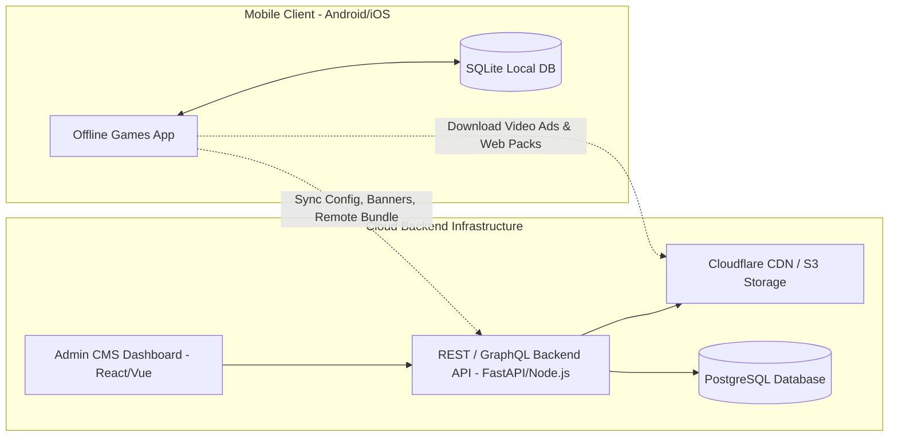

# BÁO CÁO 08: BLUEPRINT SERVER / BACKEND CMS & DATABASE SCHEMA (100% GỐC)
**Dự án:** Offline Games: No WiFi Games (`com.media720.games2020`)  
**Mục tiêu:** Trả lời chi tiết Yêu cầu 13, 19, 20 và 21 trong `readme.txt`.

---

## 1. Blueprint Kiến Trúc Server, Backend & CMS

Mặc dù ứng dụng có thể chạy 100% ngoại tuyến (Offline), để vận hành ở quy mô hàng triệu người dùng và cập nhật cấu hình linh hoạt từ xa, chúng tôi thiết kế bản vẽ kiến trúc Server / Backend CMS hoàn chỉnh:



### Chức Năng Của Hệ Thống Backend / CMS:
1. **CMS Quản Lý Danh Sách Mini-Game:** Thêm, sửa, sắp xếp thứ tự hiển thị, bật/tắt từng game, gán danh mục (Puzzle, 2 Players, Classic...).
2. **CMS Quản Lý Cấu Hình Quảng Cáo (Ad Config Remote):** Điều chỉnh từ xa tần suất xuất hiện quảng cáo (`each_n_seconds`, `each_n_levels`, `each_n_scores`) theo từng quốc gia/khu vực.
3. **Quản Lý Banners & Cross-Promotion:** Upload banner quảng cáo chéo các game khác từ Google Play.
4. **Quản Lý Video Quảng Cáo Ngoại Tuyến:** Upload video MP4 ngắn vào CDN và phân phối xuống máy client qua `offline_games_interstitial`.
5. **Xác Thực Biên Lai Mua Hàng IAP (Receipt Validation):** Lắng nghe webhook từ Google Play Developer API để xác minh giao dịch gói "Remove Ads".

---

## 2. Database Schema Chuẩn Xác 100% So Với Bản Gốc

Toàn bộ file schema hoàn chỉnh đã được tạo sẵn tại `Demo Data/schema.sql`. Dưới đây là lược đồ 7 bảng dữ liệu quan trọng:

### 2.1. Bảng `games` (Metadata của 423 Mini-Game)
```sql
CREATE TABLE `games` (
    `name` VARCHAR(100) NOT NULL PRIMARY KEY,
    `position` INTEGER NOT NULL,
    `soundToggleType` INTEGER NOT NULL DEFAULT 1,
    `configType` INTEGER NOT NULL DEFAULT 0,
    `useWideViewPortAndOverviewMode` INTEGER NOT NULL DEFAULT 1,
    `leaderboardId` VARCHAR(255) DEFAULT NULL,
    `section` VARCHAR(50) DEFAULT NULL,
    `has_rewarded_video` INTEGER NOT NULL DEFAULT 0,
    `each_n_seconds` INTEGER DEFAULT 180,
    `each_n_levels` INTEGER DEFAULT 3,
    `each_n_scores` INTEGER DEFAULT 500,
    `minimum_level` INTEGER DEFAULT 1,
    `minimum_time_played_in_game_sec` INTEGER DEFAULT 30,
    `gameFinishedAd` INTEGER NOT NULL DEFAULT 1,
    `js_popup_each_n_seconds` INTEGER DEFAULT 120,
    `remote_image_url` TEXT DEFAULT NULL,
    `remote_url_version` INTEGER DEFAULT 1,
    `remote_url` TEXT DEFAULT NULL,
    `size_mb` DECIMAL(6,2) NOT NULL DEFAULT 0.00,
    `title` VARCHAR(150) NOT NULL,
    `category` VARCHAR(50) NOT NULL,
    `isHorizontal` INTEGER NOT NULL DEFAULT 0
);
```

### 2.2. Bảng `banners` (Header Carousel Banners)
```sql
CREATE TABLE `banners` (
    `gameId` VARCHAR(100) NOT NULL,
    `position` INTEGER NOT NULL,
    `image_url` TEXT NOT NULL,
    PRIMARY KEY (`gameId`, `position`),
    FOREIGN KEY (`gameId`) REFERENCES `games`(`name`) ON DELETE CASCADE
);
```

### 2.3. Bảng `offline_games_interstitial` (Chiến Dịch Video Ads Ngoại Tuyến)
```sql
CREATE TABLE `offline_games_interstitial` (
    `version` INTEGER NOT NULL PRIMARY KEY,
    `url` TEXT NOT NULL,
    `actionUrl` TEXT NOT NULL,
    `showDailyLimit` INTEGER NOT NULL DEFAULT 5
);
```

### 2.4. Bảng `google_play_app_banners` (Quảng Cáo Ứng Dụng Khác)
```sql
CREATE TABLE `google_play_app_banners` (
    `id` INTEGER NOT NULL PRIMARY KEY,
    `packageName` VARCHAR(150) NOT NULL,
    `referrer` VARCHAR(100) NOT NULL,
    `showTimes` INTEGER NOT NULL DEFAULT 10,
    `minTimesToOpenMenuBeforeShow` INTEGER NOT NULL DEFAULT 2,
    `showEachMenuOpen` INTEGER NOT NULL DEFAULT 1,
    `title` VARCHAR(150) NOT NULL,
    `subtitle` VARCHAR(255) NOT NULL,
    `iconUrl` TEXT NOT NULL,
    `buttonText` VARCHAR(50) NOT NULL
);
```

### 2.5. Bảng `user_purchases` (Quản Lý Giao Dịch In-App Purchase)
```sql
CREATE TABLE `user_purchases` (
    `order_id` VARCHAR(100) NOT NULL PRIMARY KEY,
    `product_id` VARCHAR(50) NOT NULL,
    `purchase_time` TIMESTAMP NOT NULL DEFAULT CURRENT_TIMESTAMP,
    `purchase_state` VARCHAR(20) NOT NULL,
    `is_acknowledged` INTEGER NOT NULL DEFAULT 1,
    `price_currency` VARCHAR(10) NOT NULL DEFAULT 'USD',
    `price_amount` DECIMAL(6,2) NOT NULL
);
```

### 2.6. Bảng `user_game_stats` (Thống Kê Điểm & Lịch Sử Chơi)
```sql
CREATE TABLE `user_game_stats` (
    `game_name` VARCHAR(100) NOT NULL PRIMARY KEY,
    `high_score` INTEGER NOT NULL DEFAULT 0,
    `games_played` INTEGER NOT NULL DEFAULT 0,
    `total_time_spent_sec` INTEGER NOT NULL DEFAULT 0,
    `is_favorite` INTEGER NOT NULL DEFAULT 0,
    `last_played` TIMESTAMP NULL,
    FOREIGN KEY (`game_name`) REFERENCES `games`(`name`) ON DELETE CASCADE
);
```

---

## 3. Các Tệp Dữ Liệu Mẫu & Câu Lệnh SQL Tự Query (Yêu Cầu 19, 20, 21)

Toàn bộ các tệp sau đã được tạo sẵn trong thư mục `Demo Data/`:
1. **Dữ liệu CSV trực quan:**
   - `Demo Data/all_418_games.csv`: Danh sách 418+ game với đầy đủ thuộc tính.
   - `Demo Data/games.csv`: Tập dữ liệu 64 game phổ biến nhất.
   - `Demo Data/google_play_app_banners.csv`: Dữ liệu banner app chéo.
   - `Demo Data/offline_games_interstitial.csv`: Dữ liệu video offline ads.
   - `Demo Data/user_purchases.csv` & `user_game_stats.csv`: Dữ liệu mẫu giao dịch và điểm số.
2. **File Database SQLite thực thi:**
   - `Demo Data/games_offline_database.db`: Database SQLite thật có thể mở bằng DB Browser for SQLite hoặc DBeaver.
3. **File SQL Query mẫu (`Demo Data/queries.sql`):**
   - Query danh sách game theo thể loại kèm điểm cao nhất:
     ```sql
     SELECT g.title, g.category, COALESCE(s.high_score, 0) AS high_score, COALESCE(s.games_played, 0) AS games_played
     FROM games g
     LEFT JOIN user_game_stats s ON g.name = s.game_name
     ORDER BY g.position ASC;
     ```
   - Query danh sách game có thưởng video (Rewarded Ads):
     ```sql
     SELECT title, category, each_n_seconds, each_n_levels FROM games WHERE has_rewarded_video = 1;
     ```
   - Query tổng doanh thu mua gói Remove Ads:
     ```sql
     SELECT price_currency, COUNT(*) AS total_orders, SUM(price_amount) AS total_revenue FROM user_purchases GROUP BY price_currency;
     ```
