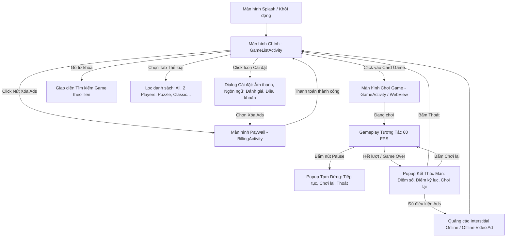

# BÁO CÁO 10: SƠ ĐỒ FLOW MÀN HÌNH & CẤU TRÚC PHÂN CẤP MENU/TABS
**Dự án:** Offline Games: No WiFi Games (`com.media720.games2020`)  
**Mục tiêu:** Trả lời chi tiết Yêu cầu 15 và 16 trong `readme.txt`.

---

## 1. Sơ Đồ Luồng Màn Hình Ứng Dụng (App Screen Navigation Flow - Yêu Cầu 15)

---

## 2. Phân Cấp Danh Sách Menu, Tab & Chức Năng (Từ Cha Xuống Con - Yêu Cầu 16)

### 2.1. Cấp Cha: Thanh Điều Khiển Trên Cùng (Header Top Bar)
- **1. Biểu Tượng Cài Đặt (Settings Icon):**
  - **1.1. Bật/Tắt Âm Thanh (Sound Effects Toggle):** Gửi broadcast cập nhật cấu hình cho toàn bộ mini-game.
  - **1.2. Bật/Tắt Rung (Haptic Vibration Toggle):** Bật/tắt phản hồi rung khi người dùng tương tác game.
  - **1.3. Chọn Ngôn Ngữ (Language Selector):** Hỗ trợ hơn 100 ngôn ngữ quốc tế.
  - **1.4. Đánh Giá Ứng Dụng (Rate App):** Mở link Google Play Store để vote 5 sao.
  - **1.5. Chính Sách Bảo Mật (Privacy Policy):** Mở WebView xem điều khoản bảo vệ dữ liệu.
  - **1.6. Điều Khoản Sử Dụng (Terms of Use):** Mở WebView xem quy định dịch vụ.
- **2. Thanh Tìm Kiếm (Search Bar):**
  - Tìm kiếm tức thời (Real-time Filtering) theo tên 423 mini-game.
- **3. Nút Mua Gói VIP (Remove Ads CTA):**
  - Mở trực tiếp màn hình `BillingActivity`.

### 2.2. Cấp Con: Hệ Thống Tab Danh Mục (Category Filter Tabs)
- **Tab 1: `Tất Cả (All Games)`** - Hiển thị toàn bộ danh sách 423 mini-game sắp xếp theo độ phổ biến (`position ASC`).
- **Tab 2: `2 Người Chơi (2 Players)`** - Lọc các game chia đôi màn hình cho 2 người chơi trên cùng 1 điện thoại (Cờ vua, Cờ caro, Ludo, Bắn tàu...).
- **Tab 3: `Giải Đố (Puzzle)`** - Lọc các game rèn luyện trí tuệ (Block Blast, Water Sort, Nuts & Bolts, 2048, Tangram...).
- **Tab 4: `Kinh Điển (Classic / Board)`** - Lọc các game bài, cờ bàn truyền thống (Solitaire, Mahjong, Minesweeper, Domino...).
- **Tab 5: `Hành Động (Arcade & Action)`** - Lọc các game phản xạ nhanh (Knife Hit, Fruit Slice, Geometry Rash, Pinball...).
- **Tab 6: `Yêu Thích (Favorites)`** - Lọc các game người chơi đã đánh dấu trái tim.

### 2.3. Cấp Thẻ: Cấu Trúc Card Game (Game Item Card)
Mỗi item game trong lưới 2 cột bao gồm:
1. **Ảnh Thumbnail (Icon 512x512):** Nạp qua thư viện Coil/Picasso.
2. **Tiêu Đề Game (Title):** Hiển thị theo ngôn ngữ địa phương hóa.
3. **Huy Hiệu Số Người Chơi (Player Badge):** Icon `1 Player` hoặc `2 Players`.
4. **Nút Trái Tim (Favorite Button):** Toggle trạng thái yêu thích cập nhật ngay vào SQLite.
5. **Điểm Cao Kỷ Lục (High Score Badge):** Hiển thị điểm kỷ lục của người chơi.
